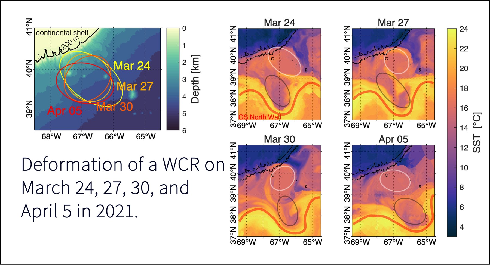
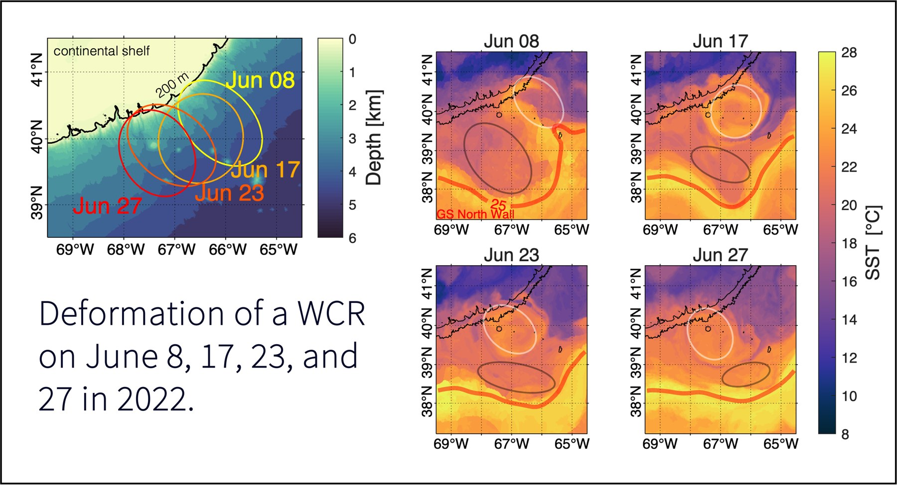

  
  <!-- Poster -->
  

    

      
Digital copy of poster

      

        <a href="/files/osm26_PS24D-1772.pdf" target="_blank" class="pdf-link">
          

            <embed 
              src="/files/osm26_PS24D-1772.pdf#toolbar=0&navpanes=0&page=1&view=FitH" 
              type="application/pdf"
            />
          

        </a>
        
<a href="/files/osm26_PS24D-1772.pdf" target="_blank">Open the poster as a PDF</a> (recommended on phones).

      

    

  

  <!-- Other examples of WCR-cyclone interactions -->
  

    

      
WCR-cyclone interactions

      

        
Interactions between WCRs and cyclones are not unique events. Below are two instances of these interactions based on satellite imagery.

         

        For each figure, the top plot is a bathymetry map 
        in the Slope Sea showing the evolution of a WCR’s SSH-derived shape during its interaction with a cyclone on four different dates, and the right plot is an SST map on each of these dates showing the WCR (white contours) and deep cyclone (black contour, -30 cm SSH) interaction at different stages, where the thick red line is the 25-cm SSH contour to estimate the GS North Wall. The 200-m isobath contour delineating the continental shelf is shown in black in all figures. 
        

        
         
        

      

    

  

  <!-- WCRs as drivers of cross-slope physical variability -->
  

    

      
The impact of WCRs on shelf water export

      

        
Our paper entitled "The impact of Gulf Stream warm core rings on shelf water export in the Northwestern Atlantic" is currently being prepared for submission. This paper investigates the multi-scale temporal variability (daily, annual, and interannual) of shelf water streamer export by WCRs and the relationship between streamer transport volumes and interactions involving the WCR and circulation features in the Slope Sea associated with the Gulf Stream. We estimate the likelihood for a WCR that is present in the western Slope Sea to entrain a streamer in 2021-2025 using satellite imagery (sea surface height, sea surface temperature, and sea surface chlorophyll). We also follow the evolution and streamer export impact of single WCR from April to September 2023 that underwent almost all possible interactions with the Gulf Stream system that all WCRs experience. Many of these interactions occurred at the same time as the ring entrained shelf water streamers.

      

    

  

  <!-- Realistic model -->
  

    

      
Deep ocean processes associated with the Gulf Stream

      

        
For more information on the mechanisms that drive benthic storms under the Gulf Stream, see this paper by Sean Chen: 
        
            Chen, S.-Y. S., Marchal, O., Gardner, W., & Andres, M. (2024). Intensified currents associated with benthic storms underneath an eddying jet. Journal of Geophysical Research: Oceans, 129, e2024JC020963. <a href="https://doi.org/10.1029/2024JC020963 ">https://doi.org/10.1029/2024JC020963</a>

      

    

  

